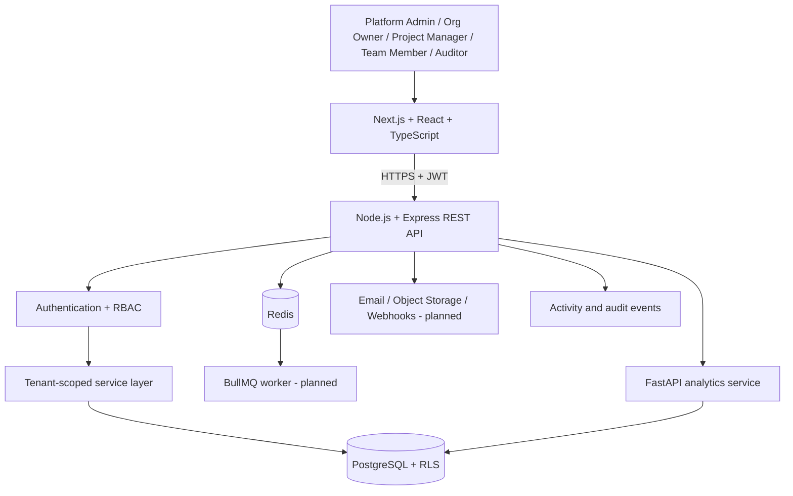

# WorkSphere Architecture

## Purpose
A multi-tenant SaaS platform where organizations manage projects, milestones, tasks, comments, files, workflow automation, notifications, analytics, and audit history.

## Logical architecture

## Request flow
1. Browser sends credentials to `/api/auth/login`.
2. API verifies the password hash and issues a short-lived signed JWT.
3. Frontend sends the JWT as a Bearer token.
4. Authentication middleware verifies token signature and expiry.
5. Authorization middleware checks role permissions.
6. Service opens a PostgreSQL transaction and sets `app.tenant_id`.
7. Tenant-scoped SQL and PostgreSQL RLS constrain records to that tenant.
8. Mutations add activity/audit events.
9. Analytics service aggregates project and task metrics.

## Core roles
- `platform_admin`: platform operations.
- `organization_owner`: organization-wide administration.
- `project_manager`: project and task management.
- `team_member`: assigned work and collaboration.
- `auditor`: read-only audit visibility.

## Core entities
Tenant → Users, Projects → Milestones, Tasks → Comments; Activity Events and Audit Logs capture changes.

## Reliability and security decisions
- Parameterized SQL prevents SQL injection.
- bcrypt hashes passwords.
- JWT is short-lived; refresh-token rotation is a required future enhancement.
- Tenant identity comes from a verified JWT, never from an untrusted request body.
- Use database transactions for multi-step changes.
- Use idempotency keys for retryable external operations.
- Keep analytics service private and authenticate service-to-service calls before production.
- Never log passwords, tokens, secrets, or sensitive payloads.

## Assessment extension plan
Add invitations and membership acceptance; file metadata plus private object storage; workflow rules and event processing; Redis/BullMQ with retry/backoff and dead-letter handling; webhook signature verification; email integration; SSE/WebSocket updates; export processing; OpenAPI examples; comprehensive tests; deployment, monitoring, backup/restore, and incident drills.
